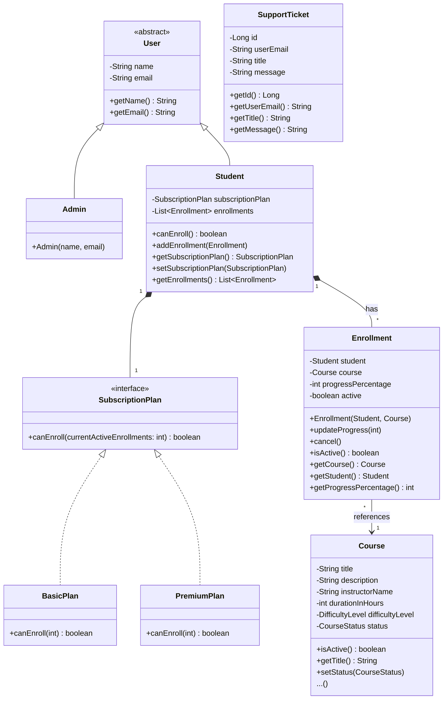

# Modelagem da Solução - AcademiaDev

## Diagrama de Classes UML

## Justificativa para as Escolhas de Design

**1. Encapsulamento:**
Todos os atributos das classes de domínio (como `Student`, `Course`, `Enrollment`) são mantidos como `private`, garantindo que o estado interno do objeto não seja alterado de forma inconsistente por agentes externos. O acesso e a mutação ocorrem por meio de métodos públicos (`getters` e `setters`), e as regras de negócio de modificação (como a validação do progresso) residem dentro dos próprios objetos (ex: `updateProgress` no `Enrollment`).

**2. Herança:**
A classe abstrata `User` concentra atributos e comportamentos comuns a todos os usuários da plataforma (`name` e `email`). As classes `Admin` e `Student` herdam de `User`. Isso evita duplicação de código e permite que o sistema identifique polimorficamente qualquer tipo de usuário para operações de autenticação.

**3. Polimorfismo e Interfaces:**
Foi criada a interface `SubscriptionPlan`, que possui o método `canEnroll(int)`. As classes `BasicPlan` e `PremiumPlan` implementam essa interface, possuindo cada uma sua própria lógica de negócio (o `BasicPlan` limita a 3 cursos e o `PremiumPlan` não possui limite). O `Student` apenas interage com a interface `SubscriptionPlan` de forma polimórfica, aplicando o princípio de Inversão de Dependência (SOLID) e permitindo que novos planos sejam adicionados sem alterar a classe `Student`.

**4. Classe de Associação (`Enrollment`):**
O relacionamento entre `Student` e `Course` é de muitos-para-muitos com dados adicionais (progresso e status de atividade). Por isso, uma classe de associação, `Enrollment` (Matrícula), foi modelada de forma explícita. O `Enrollment` conecta as duas pontas da relação e armazena o `progressPercentage` e o sinalizador `active` para tratamento de cancelamentos ("soft delete"), permitindo reativar ou manter um histórico no futuro caso necessário, ao mesmo tempo que libera a vaga no limite do plano básico.
