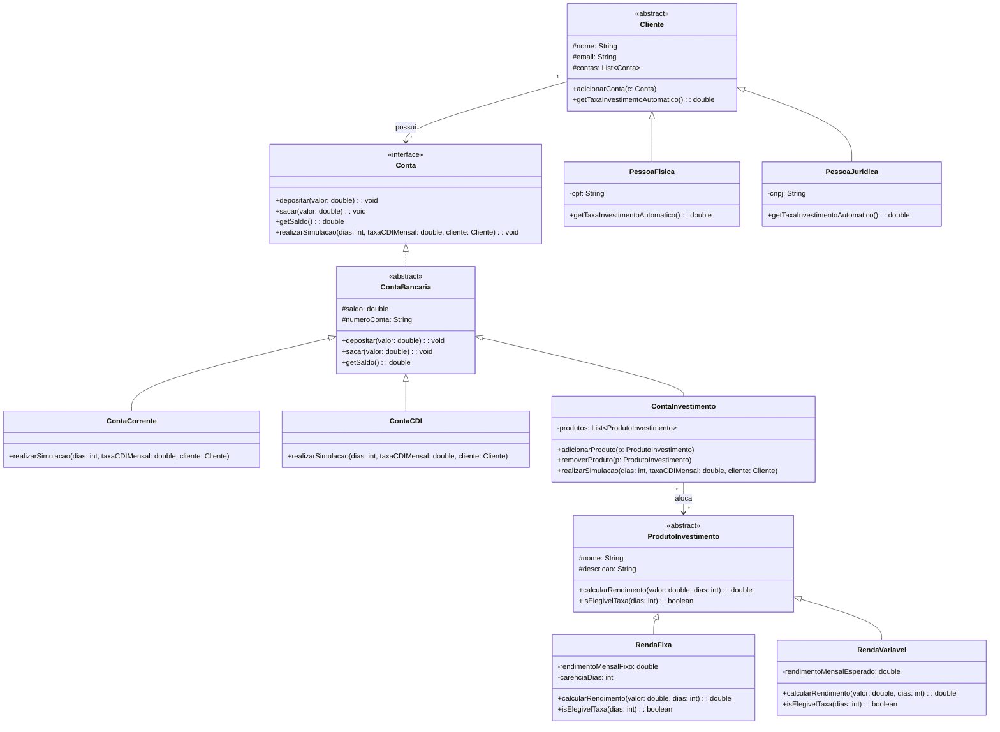

# Escritório de Investimentos VcRiquinho - Protótipo

## 1. Diagrama de Classes UML

## 2. Escolhas de Design e Justificativas

A solução foi estruturada aplicando fortemente os conceitos de Programação Orientada a Objetos (POO):

### Encapsulamento
Todos os atributos das classes foram definidos como `private` ou `protected` (para quando são utilizados por subclasses). O acesso e a modificação desses dados ocorrem unicamente por meio de métodos públicos (`getters`, `setters`, `depositar`, `sacar`), garantindo a segurança dos estados dos objetos. O saldo de uma conta, por exemplo, não pode ser alterado livremente, apenas mediante a chamada formal a saques e depósitos.

### Classes Abstratas e Interfaces
- **Interface `Conta` e Classe Abstrata `ContaBancaria`**: A interface define os "contratos" obrigatórios de qualquer conta que exista no sistema (operações bancárias básicas e a assinatura para simulação). A classe abstrata `ContaBancaria` provê a implementação padrão para manipulação do saldo, evitando código repetitivo nas contas que irão existir.
- **Classes Abstratas `Cliente` e `ProdutoInvestimento`**: Isolam propriedades genéricas de clientes e produtos, delegando os detalhes restritos (como a exata taxa que PF ou PJ paga) para as classes filhas por meio de métodos abstratos (ex: `getTaxaInvestimentoAutomatico()`).

### Herança
Foi extensivamente aplicada para especializar comportamentos sem repetição (DRY - Don't Repeat Yourself):
- Clientes (`PessoaFisica` e `PessoaJuridica`) herdam atributos genéricos (nome, e-mail) de `Cliente`, além de providenciarem suas próprias taxas.
- Contas (`ContaCorrente`, `ContaCDI` e `ContaInvestimento`) herdam a lógica do saldo vinda de `ContaBancaria`.
- Produtos (`RendaFixa` e `RendaVariavel`) herdam informações descritivas comuns e impõem as lógicas específicas de cálculo do rendimento e carência.

### Polimorfismo
- **Cálculo das taxas de serviço**: O método `ContaInvestimento.realizarSimulacao` itera de forma agnóstica e transparente sobre a lista de `ProdutoInvestimento`. Ele simplesmente invoca `produto.calcularRendimento()` e `produto.isElegivelTaxa()`, e cada classe filha (Renda Fixa ou Variável) vai responder de forma diferente dependendo das próprias regras de negócio, descartando a necessidade de dezenas de estruturas condicionais `if/else` no motor da aplicação.
- O aviso importante de isenção de taxa (alerta na tela sobre período de carência) ocorre dinamicamente em virtude do método polimórfico `isElegivelTaxa(dias)`, que no caso de renda variável retorna `true` sempre, mas em renda fixa efetua uma verificação na carência de dias. 
- **Simulação nas contas do cliente**: O `Cliente` detém uma lista polimórfica `List<Conta>`. Ao interagir com elas, invoca-se `conta.realizarSimulacao()`, permitindo que o sistema execute o algorítmo pertinente ao tipo de conta que aquele cliente tem, variando de Pessoa para Pessoa de forma dinâmica.

Na classe principal `Main`, implementamos o protótipo inicial através de chamadas em script (Linha de Comando) que ilustram perfeitamente o CRUD do sistema e realizam as simulações, satisfazendo inteiramente as requisições de regras de negócios propostas pelos analistas da startup VcRiquinho.
